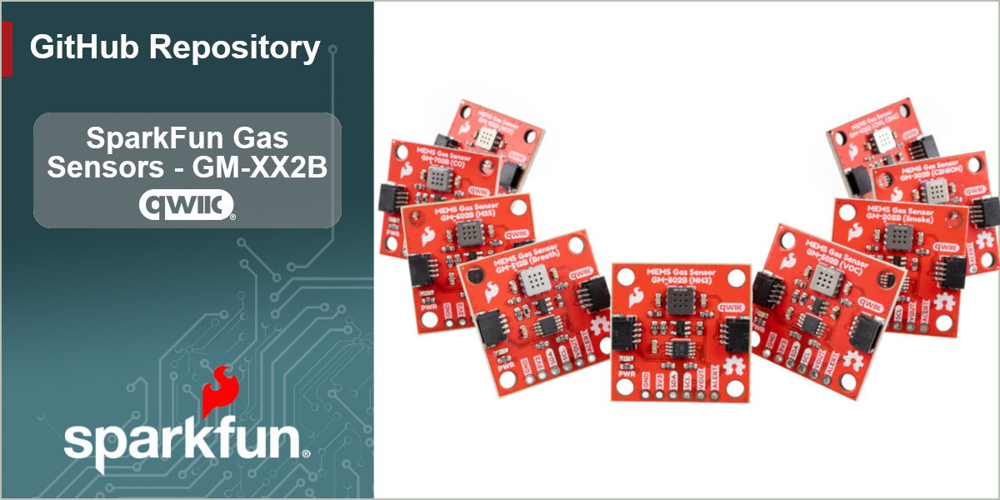

-----------------------------------------------------------------------

The SparkFun Gas Sensor - GM-XX2B (Qwiic) are a series of nine compact gas-sensing breakouts built around the GM-XX2B series of gas sensors from Winsen. The GM-XX2B sensors are metal-oxide semiconductor (MOS) sensors that measures the specified gas (or gases), and its analog output rises with gas concentration. To make it Qwiic-friendly, we fed that analog signal into an onboard 10-bit I2C ADC, so you can read gas levels straight over I2C with no external ADC required. The boards includes a pair of Qwiic connectors as well as a PTH header that breaks out the raw analog VOUT alongside SDA and SCL for non-Qwiic setups.

This series includes Qwiic breakouts for the [GM-102B Nitrogen Dioxide Gas Sensor](https://www.sparkfun.com/sparkfun-nitrogen-dioxide-gas-sensor-gm-102b-qwiic.html), [GM-202B Ethanol & Smoke Gas Sensor](https://www.sparkfun.com/sparkfun-ethanol-smoke-gas-sensor-gm-202b-qwiic.html), [GM-302B Alcohol/Ethanol Gas Sensor](https://www.sparkfun.com/sparkfun-alcohol-ethanol-gas-sensor-gm-302b-qwiic.html), [GM-402B Combustible Gas Sensor](https://www.sparkfun.com/sparkfun-combustible-gas-sensor-gm-402b-qwiic.html), [GM-502B VOC Gas Sensor](https://www.sparkfun.com/sparkfun-voc-gas-sensor-gm-502b-qwiic.html), [GM-512B Bad Breath Gas Sensor](https://www.sparkfun.com/sparkfun-bad-breath-gas-sensor-gm-512b-qwiic.html), [GM-602B Hydrogen Sulfide Gas Sensor](https://www.sparkfun.com/sparkfun-hydrogen-sulfide-gas-sensor-gm-602b-qwiic.html), [GM-702B Carbon Monoxide Gas Sensor](https://www.sparkfun.com/sparkfun-carbon-monoxide-gas-sensor-gm-702b-qwiic.html) and [GM-802B Ammonia Gas Sensor](https://www.sparkfun.com/sparkfun-ammonia-gas-sensor-gm-802b-qwiic.html).

**Note:** Out of the box the GM-XX2B sensors are great for relative measurement and threshold alerts. Absolute ppm readings require calibration, and the sensor must be preheated before first use. See the Hookup Guide for details.

## Repository Contents

* **/docs** - Documentation files for GitHub pages
* **/Documents** - Datasheets, additional product information
* **/Hardware** - KiCad design files (.kicad_sch, .kicad_pcb)
* **/Production** - Production panel files

## Documentation

* **[Library](https://github.com/sparkfun/SparkFun_GM-X02B_Arduino_Library)** - Arduino library for the SparkFun Qwiic MEMS Hydrogen Sulfide Sensor - GM-602B.
* **[Hookup Guide](https://docs.sparkfun.com/SparkFun_Qwiic_MEMS_Hydrogen_Sulfide_Sensor_GM-602B/)** - Basic hookup guide for the SparkFun Qwiic MEMS Hydrogen Sulfide Sensor - GM-602B, including preheating, calibration, and handling cautions.

## Product Versions

* **[SEN-32064](https://www.sparkfun.com/sparkfun-nitrogen-dioxide-gas-sensor-gm-102b-qwiic.html)** - Initial release of the SparkFun Nitrogen Dioxide Gas Sensor - GM-102B (Qwiic).
* **[SEN-32065](https://www.sparkfun.com/sparkfun-ethanol-smoke-gas-sensor-gm-202b-qwiic.html)** - Initial release of the SparkFun Ethanol & Smoke Gas Sensor - GM-202B (Qwiic).
* **[SEN-32066](https://www.sparkfun.com/sparkfun-alcohol-ethanol-gas-sensor-gm-302b-qwiic.html)** - Initial release of the SparkFun Alcohol/Ethanol Gas Sensor - GM-302B (Qwiic).
* **[SEN-32067](https://www.sparkfun.com/sparkfun-combustible-gas-sensor-gm-402b-qwiic.html)** - Initial release of the SparkFun Combustible Gas Sensor - GM-402B (Qwiic).
* **[SEN-32068](https://www.sparkfun.com/sparkfun-voc-gas-sensor-gm-502b-qwiic.html)** - Initial release of the SparkFun VOC Gas Sensor - GM-502B (Qwiic).
* **[SEN-32069](https://www.sparkfun.com/sparkfun-bad-breath-gas-sensor-gm-512b-qwiic.html)** - Initial release of the SparkFun Bad Breath Gas Sensor - GM-512B (Qwiic).
* **[SEN-31734](https://www.sparkfun.com/sparkfun-hydrogen-sulfide-gas-sensor-gm-602b-qwiic.html)** - Initial release of the SparkFun Bad Breath Gas Sensor - GM-602B (Qwiic).
* **[SEN-32070](https://www.sparkfun.com/sparkfun-carbon-monoxide-gas-sensor-gm-702b-qwiic.html)** - Initial release of the	SparkFun Carbon Monoxide Gas Sensor - GM-702B (Qwiic).
* **[SEN-32071](https://www.sparkfun.com/sparkfun-ammonia-gas-sensor-gm-802b-qwiic.html)** - Initial release of the SparkFun Ammonia Gas Sensor - GM-802B (Qwiic).

## License Information

This product is _**open source**_!

Please review the LICENSE.md file for license information.

If you have any questions or concerns about licensing, please contact technical support on our [SparkFun forums](https://forum.sparkfun.com/viewforum.php?f=152).

Distributed as-is; no warranty is given.

_- Your friends at SparkFun._
