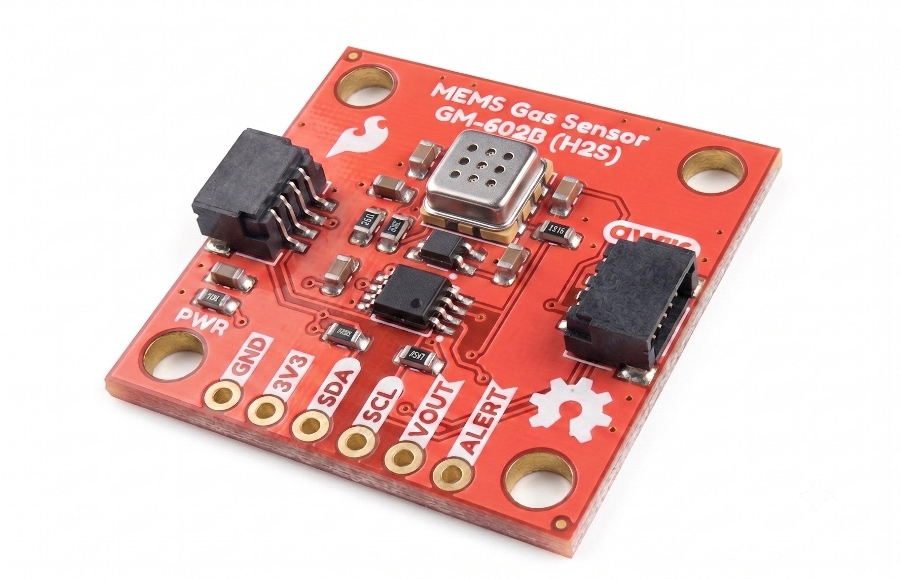

# SparkFun Qwiic MEMS Gas Sensors - GM-X02B Series

The SparkFun Qwiic MEMS Hydrogen Sulfide Sensor is a compact gas-sensing breakout built around the GM-602B from Winsen. The GM-602B is a metal-oxide semiconductor (MOS) sensor that measures hydrogen sulfide (H2S), and its analog output rises with gas concentration. To make it Qwiic-friendly, we fed that analog signal into an onboard MCP3221 12-bit I2C ADC, so you can read H2S levels straight over I2C with no external ADC required. The board includes two Qwiic connectors plus a PTH header that breaks out the raw analog VOUT alongside SDA and SCL for non-Qwiic setups.

**Note:** Out of the box the GM-602B is great for relative measurement and threshold alerts. Absolute ppm readings require calibration, and the sensor must be preheated before first use. See the Hookup Guide for details.

## Repository Contents

* **/docs** - Documentation files for GitHub pages
* **/Documents** - Datasheets, additional product information
* **/Hardware** - KiCad design files (.kicad_sch, .kicad_pcb)
* **/Production** - Production panel files

## Documentation

* **[Library](https://github.com/sparkfun/SparkFun_GM-602B_Arduino_Library)** - Arduino library for the SparkFun Qwiic MEMS Hydrogen Sulfide Sensor - GM-602B.
* **[Hookup Guide](https://docs.sparkfun.com/SparkFun_Qwiic_MEMS_Hydrogen_Sulfide_Sensor_GM-602B/)** - Basic hookup guide for the SparkFun Qwiic MEMS Hydrogen Sulfide Sensor - GM-602B, including preheating, calibration, and handling cautions.

## Product Versions

* **[SEN-XXXXX](https://www.sparkfun.com/products/XXXXX)** - Initial release of the SparkFun Qwiic MEMS Hydrogen Sulfide Sensor - GM-602B.

## License Information

This product is _**open source**_!

Please review the LICENSE.md file for license information.

If you have any questions or concerns about licensing, please contact technical support on our [SparkFun forums](https://forum.sparkfun.com/viewforum.php?f=152).

Distributed as-is; no warranty is given.

_- Your friends at SparkFun._
